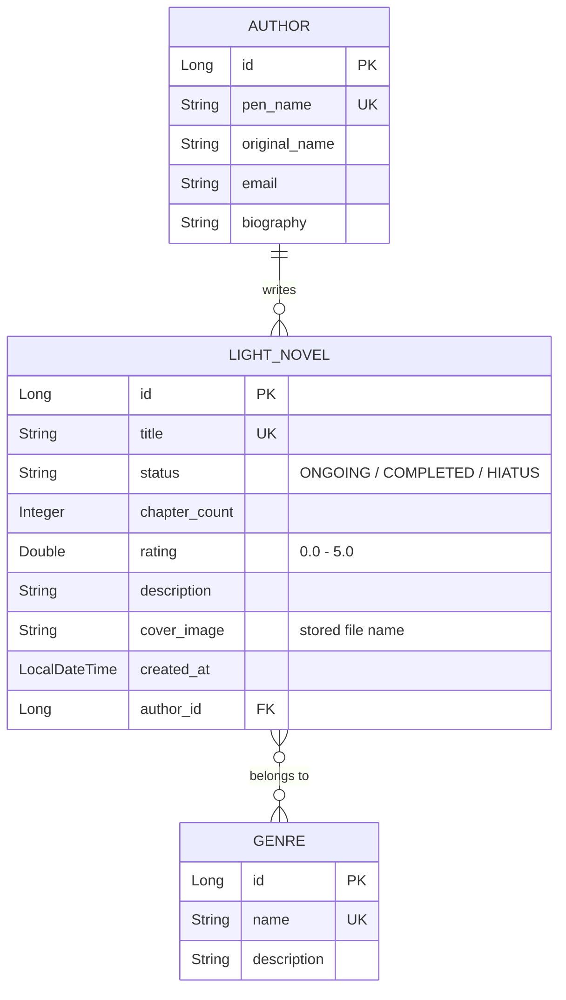

# Light Novel Library

A Spring Boot web application for keeping track of **light novels** (and web novels), their
**authors** and **genres**. It has server-rendered pages (Thymeleaf) and a JSON REST API.
Novels can have an uploaded cover image, and the lists support search, filters, sorting and
pagination.

## Tech stack

| Part          | Technology                                       |
|---------------|--------------------------------------------------|
| Language      | Java 17                                          |
| Framework     | Spring Boot 3.5 (Web MVC, Data JPA, Validation)  |
| Views         | Thymeleaf + Bootstrap 5                          |
| Database      | H2 (file based, stored in `./data`)              |
| Build         | Maven (wrapper included)                         |

## How to run

Requirements: **JDK 17 or newer**. Maven does not need to be installed.

```bash
# Windows (PowerShell or cmd)
.\mvnw.cmd spring-boot:run

# macOS / Linux
./mvnw spring-boot:run
```

Then open <http://localhost:8080>.

On the first start the database is filled with sample data: 22 popular novels from a public
ranking list, their 19 authors and 16 genres (titles, authors, chapter counts, ratings and
genres are real; the synopses are short summaries written for this project). To start from
scratch, stop the app and delete the `data/` and `uploads/` folders.

| URL | What it is |
|-----|------------|
| <http://localhost:8080> | Dashboard (top rated, recently added, stats) |
| <http://localhost:8080/novels> | Novels (search, author/genre/status filters, sorting, pagination) |
| <http://localhost:8080/authors> | Authors |
| <http://localhost:8080/genres> | Genres with novel count and average rating |
| <http://localhost:8080/api/novels> | REST API (JSON) |
| <http://localhost:8080/h2-console> | H2 console: JDBC URL `jdbc:h2:file:./data/librarydb`, user `sa`, empty password |

Run the tests with `.\mvnw.cmd test` (or `./mvnw test`).

## Data model



- **Author 1 — N LightNovel**: `@OneToMany(mappedBy = "author", cascade = ALL)` in `Author`,
  `@ManyToOne` + `@JoinColumn(name = "author_id")` in `LightNovel`. Deleting an author
  deletes their novels.
- **LightNovel N — M Genre**: `@ManyToMany` + `@JoinTable(name = "novel_genres")` in
  `LightNovel` (owning side), `@ManyToMany(mappedBy = "genres")` in `Genre`. Deleting a genre
  keeps the novels and only removes the link.
- `status` is a Java enum (`NovelStatus`) stored as text with `@Enumerated(EnumType.STRING)`.

## Project structure

```
src/main/java/com/example/library
├── LibraryApplication.java
├── config/       @Configuration  - WebConfig (serves /uploads/**), DataInitializer (sample data)
├── controller/   @Controller     - HomeController, LightNovelController, AuthorController, GenreController
│                 @RestController - LightNovelRestController, GenreRestController
├── service/      @Service        - LightNovelService, AuthorService, GenreService, FileStorageService
├── repository/   @Repository     - LightNovelRepository, AuthorRepository, GenreRepository
├── entity/       @Entity         - LightNovel, Author, Genre (+ NovelStatus enum)
├── dto/          form / JSON objects with validation (LightNovelDto, AuthorDto, GenreDto, ...)
└── exception/    custom exceptions + @ControllerAdvice / @RestControllerAdvice handlers
src/main/resources
├── templates/    Thymeleaf pages (novels/, authors/, genres/, fragments/, error/)
├── static/css/   style.css
└── application.properties
```

Requests always go **controller → service → repository**. All dependencies are wired with
**constructor injection**; there is no `@Autowired` anywhere in the project.

## Requirements checklist

### 1. Project structure and bean management
| Requirement | Where |
|---|---|
| Layered packages | `controller`, `service`, `repository`, `entity` (+ `dto`, `config`, `exception`) |
| Stereotype annotations | `@Controller`/`@RestController` on controllers, `@Service` on services, `@Repository` on repositories, `@Configuration` on `WebConfig` and `DataInitializer` |
| Constructor injection only | Every controller, service and config class has a constructor that receives its dependencies |

### 2. Database and Spring Data JPA
| Requirement | Where |
|---|---|
| 3+ entities | `LightNovel`, `Author`, `Genre` |
| Two relationship types | `@OneToMany`/`@ManyToOne` (Author–LightNovel), `@ManyToMany` (LightNovel–Genre) |
| Repositories extend `JpaRepository` | `LightNovelRepository`, `AuthorRepository`, `GenreRepository` |
| Method-name queries | `existsByTitleIgnoreCaseAndIdNot`, `countByStatus`, `findTop5ByRatingNotNullOrderByRatingDescTitleAsc`, `findByAuthorIdOrderByTitleAsc`, `existsByPenNameIgnoreCaseAndIdNot`, `findAllByOrderByNameAsc`, ... |
| `@Query` custom queries | `LightNovelRepository.search` (JOIN + LIKE + optional filters + paging), `LightNovelRepository.clearCoverImage` (`@Modifying` UPDATE), `LightNovelRepository.sumChapters` (native SQL), `AuthorRepository.searchByName`, `AuthorRepository.findAuthorsWithAtLeast` (GROUP BY / HAVING), `GenreRepository.findAllWithNovelCount` (COUNT + AVG into a DTO) |
| `@Transactional` | Every service method that changes data (`create`, `update`, `delete`, `updateCover`, `removeCover`); read methods use `@Transactional(readOnly = true)` |

### 3. Controllers and request handling
| Requirement | Where |
|---|---|
| `@GetMapping` | Lists, details and forms in every controller |
| `@PostMapping` | `POST /novels`, `/authors`, `/genres`, `/novels/{id}/cover`, `/api/novels`, `/api/genres` |
| `@PutMapping` | `PUT /novels/{id}`, `/authors/{id}`, `/genres/{id}`, `/api/novels/{id}`, `/api/genres/{id}` |
| `@DeleteMapping` | `DELETE /novels/{id}`, `/novels/{id}/cover`, `/authors/{id}`, `/genres/{id}`, `/api/...` |
| `@PathVariable` | All `/{id}` endpoints |
| `@RequestParam` | Search and filters (`keyword`, `authorId`, `genreId`, `status`), paging (`page`, `size`, `sort`, `dir`) and file parameters (`coverFile`, `file`) |
| `@ModelAttribute` | HTML forms: `LightNovelController`, `AuthorController`, `GenreController` |
| `@RequestBody` | REST API: `LightNovelRestController`, `GenreRestController` |

HTML forms can only send GET and POST, so PUT and DELETE forms use Spring's hidden
`_method` field (`spring.mvc.hiddenmethod.filter.enabled=true`). Thymeleaf adds it
automatically for `th:method="put"` / `th:method="delete"`.

### 4. Validation, file upload and pagination
| Requirement | Where |
|---|---|
| JSR-303 annotations | `LightNovelDto`, `AuthorDto`, `GenreDto`: `@NotBlank`, `@NotNull`, `@NotEmpty`, `@Size`, `@Min`, `@Max`, `@DecimalMin`, `@DecimalMax`, `@Email` |
| `@Valid` on incoming objects | Every `@ModelAttribute` and `@RequestBody` parameter; errors are shown next to the form fields (HTML) or returned as JSON (API) |
| File upload with `MultipartFile` | Novel form and novel details page (`enctype="multipart/form-data"`), and `POST /api/novels/{id}/cover` |
| File stored on disk, name in DB | `FileStorageService` saves the image to `uploads/` with a unique name; the name is stored in `light_novels.cover_image` and served at `/uploads/{name}` |
| Pagination & sorting | `/novels` and `/authors` build `PageRequest.of(page, size, Sort.by(...))`; the REST API receives a `Pageable` directly (`@PageableDefault`) |

## REST API

All responses are JSON. Errors use the problem-details format (`status`, `title`, `detail`,
and `errors` for validation failures).

| Method | URL | Description |
|--------|-----|-------------|
| GET    | `/api/novels?keyword=&authorId=&genreId=&status=ONGOING&page=0&size=10&sort=rating,desc` | Page of novels |
| GET    | `/api/novels/{id}` | One novel |
| POST   | `/api/novels` | Create a novel (JSON body) |
| PUT    | `/api/novels/{id}` | Update a novel (JSON body) |
| DELETE | `/api/novels/{id}` | Delete a novel |
| POST   | `/api/novels/{id}/cover` | Upload a cover (`multipart/form-data`, part name `file`) |
| DELETE | `/api/novels/{id}/cover` | Remove the cover |
| GET    | `/api/genres?page=0&size=20&sort=name` | Page of genres |
| GET / POST / PUT / DELETE | `/api/genres[/{id}]` | Genre CRUD |

Example (author 2 is Cuttlefish That Loves Diving, genre 5 is Fantasy):

```bash
curl -X POST http://localhost:8080/api/novels \
     -H "Content-Type: application/json" \
     -d '{"title": "My New Novel", "status": "ONGOING", "chapterCount": 12,
          "rating": 4.2, "authorId": 2, "genreIds": [5]}'

curl -F "file=@cover.jpg" http://localhost:8080/api/novels/1/cover
```

## Uploads

- Allowed types: JPG, PNG, GIF, WEBP, up to 5 MB.
- Files are saved as `uploads/<random-uuid>.<ext>` so names never clash and users
  cannot write outside the folder.
- When a cover is replaced or a novel is deleted, the old file is removed **after** the
  database transaction commits. If the transaction rolls back, a newly saved file is
  deleted again, so the disk and the database stay in sync.
